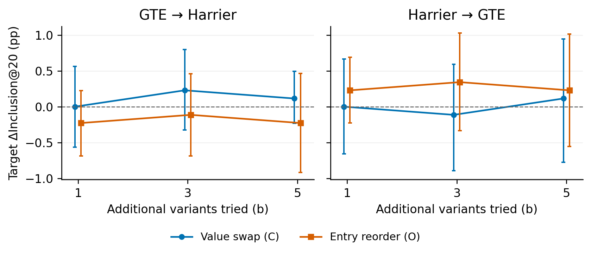

# 確認實驗：商品欄位值錯填、換序對照與跨 encoder 曝光轉移

本輪使用 208 個與開發集隔離的新查詢、876 個 Exact query–product pairs、871 件商品。每商品固定五組配對、11 個完整版本；兩模型均以完整 42,994 商品庫計算獨立 target-only 排名。未修改論文。

錯填會改變部分原本 Exact 商品的 Top-20 曝光，但本次兩模型的錯填 crossing 點估計均低於保持配對正確的完整欄位換序。跨模型的 12/12 個「方向 × 條件 × 預算」ΔInclusion@20 區間涵蓋 0；本次未得到穩定正向轉移的證據，這也不是效果等於零的等價性證明。

## RQ1：新查詢是否重現隨機錯填的曝光影響？

gte 的隨機錯填 crossing 為 1.48 [0.96, 2.09]%，原始事件 65/4380 次改動；entry 36 次、exit 29 次。
其淨 ΔInclusion@20 為 0.16 [-0.39, 0.74] pp，少量進出不代表平均曝光改善。
harrier 的隨機錯填 crossing 為 0.66 [0.32, 1.07]%，原始事件 29/4380 次改動；entry 14 次、exit 15 次。
其淨 ΔInclusion@20 為 -0.02 [-0.33, 0.32] pp，少量進出不代表平均曝光改善。
在新的確認查詢上，重現了錯填可改變 Top-20 曝光的現象。
前一輪是開發資料、每 pair 一次交換；本輪每 pair 五次取平均，不能把兩輪當作同一批獨立觀察合併，也不以原始事件總數比較效果大小。

| Encoder | Edit | Entry: events/trials; % [95% CI] | Exit: events/trials; % [95% CI] | Crossing: events/trials; % [95% CI] |
|---|---|---|---|---|
| GTE | C | 36/3010; 1.20 [0.61, 1.91] | 29/1370; 2.12 [1.10, 3.35] | 65/4380; 1.48 [0.96, 2.09] |
| GTE | O | 45/3010; 1.50 [0.87, 2.21] | 40/1370; 2.92 [1.74, 4.31] | 85/4380; 1.94 [1.35, 2.60] |
| Harrier | C | 14/2900; 0.48 [0.14, 0.94] | 15/1480; 1.01 [0.41, 1.74] | 29/4380; 0.66 [0.32, 1.07] |
| Harrier | O | 21/2900; 0.72 [0.31, 1.22] | 23/1480; 1.55 [0.67, 2.63] | 44/4380; 1.00 [0.57, 1.49] |

Trials = 5 × baseline-eligible pairs. Estimates average five edits within each pair; CIs resample queries, not edits.

表 1 的事件／trials 是原始五組改動計數；率先在 pair 內平均，再彙整。Entry 分母只含原本 Top-20 外 pairs，exit 只含原本內 pairs，crossing 為全部 pairs。trials 不是獨立樣本。主文優先解讀曝光門檻，分數與排名差的次要分布另存 results/secondary_deltas.csv。

| 模型 | A 原始排名 | pairs / 全部 | 比例 |
|---|---|---|---|
| gte | 1-20 | 274/876 | 31.28% |
| gte | 21-100 | 270/876 | 30.82% |
| gte | 101-1000 | 252/876 | 28.77% |
| gte | 1001+ | 80/876 | 9.13% |
| harrier | 1-20 | 296/876 | 33.79% |
| harrier | 21-100 | 295/876 | 33.68% |
| harrier | 101-1000 | 233/876 | 26.60% |
| harrier | 1001+ | 52/876 | 5.94% |

原始 rank 分布限制能觀察到的 crossing 機會；遠離第 20 名的改動即使改變排名，也可能不跨越曝光門檻。正式樣本按 hash 抽取，沒有只挑靠近門檻的商品。

## 與保持正確配對的換序有何不同？

下表是 C−O 的 paired query bootstrap 差異（百分點）。正 crossing 差表示錯填較常改變門檻狀態，不表示錯填較有利；entry 與 exit 必須分開看。兩條件都改動呈現方式，C−O 不能解讀成純粹的模型內部 binding 效應。

| 模型 | 指標 | C−O pp | 95% CI pp |
|---|---|---|---|
| gte | entry | -0.30 | [-0.87, 0.27] |
| gte | exit | -0.80 | [-1.76, 0.17] |
| gte | crossing | -0.46 | [-0.97, 0.05] |
| gte | net | 0.05 | [-0.42, 0.51] |
| harrier | entry | -0.24 | [-0.55, 0.04] |
| harrier | exit | -0.54 | [-1.32, 0.14] |
| harrier | crossing | -0.34 | [-0.68, -0.02] |
| harrier | net | 0.02 | [-0.27, 0.33] |

兩模型的 C crossing 都低於 O：GTE 的 paired 差異區間仍涵蓋 0；Harrier 的區間為負，顯示這個樣本中完整換序更常改變曝光門檻。不能由此主張錯填具有較大的曝光優勢，也不能把單一模型、未校正多項比較的區間概括為普遍規律。

## RQ2：來源模型選出的優勢是否保留？

gte → harrier、C、b=5：來源 Δ 1.94 [1.12, 2.88] pp；目標 Δ 0.11 [-0.23, 0.49] pp。目標模型區間涵蓋 0，尚不足以確認正向平均曝光優勢。
gte → harrier、O、b=5：來源 Δ 2.85 [1.79, 4.02] pp；目標 Δ -0.23 [-0.92, 0.46] pp。目標模型區間涵蓋 0，尚不足以確認正向平均曝光優勢。
harrier → gte、C、b=5：來源 Δ 0.80 [0.24, 1.43] pp；目標 Δ 0.11 [-0.78, 0.94] pp。目標模型區間涵蓋 0，尚不足以確認正向平均曝光優勢。
harrier → gte、O、b=5：來源 Δ 1.37 [0.68, 2.17] pp；目標 Δ 0.23 [-0.56, 1.01] pp。目標模型區間涵蓋 0，尚不足以確認正向平均曝光優勢。

| Source → target | Edit | Changed / all | Source Δ pp [95% CI] | Target Δ pp [95% CI] | Target entry | Target exit |
|---|---|---|---|---|---|---|
| GTE → Harrier | C | 830/876 | 1.94 [1.12, 2.88] | 0.11 [-0.23, 0.49] | 2/580 | 1/296 |
| GTE → Harrier | O | 817/876 | 2.85 [1.79, 4.02] | -0.23 [-0.92, 0.46] | 4/580 | 6/296 |
| Harrier → GTE | C | 795/876 | 0.80 [0.24, 1.43] | 0.11 [-0.78, 0.94] | 8/602 | 7/274 |
| Harrier → GTE | O | 823/876 | 1.37 [0.68, 2.17] | 0.23 [-0.56, 1.01] | 7/602 | 5/274 |

Budget b=5 excludes the common A baseline. All pairs, including retained A, are included. Source gains are selected in-sample.

A 始終可選，完全同分保留 A、其次取較小 j；所有 pairs 都納入，包括保留 A。來源模型的最高分選擇使來源改善具有選擇偏差，不能單獨視為泛化證據。這是已知同一 query 且可取得來源分數的跨 encoder 測試，不是對未知查詢的轉移。

圖 1：目標模型 ΔInclusion@20 與 95% query-cluster bootstrap CI。b=1,3,5 使用同一固定清單的巢狀前綴；A 不計入新增嘗試數。各預算、分層及多項差異為探索性比較，未作多重比較校正。完整選擇與來源／目標結果見 rq2_choices.csv、rq2_summary.csv。

## 是否集中於少數 query 或特定交換類型？

| 分析 | 模型／方向 | 條件 | 有 crossing 的 query 數 | 事件最多 5 queries 的占比 |
|---|---|---|---|---|
| random | gte | C | 32/208 | 33.8% |
| random | gte | O | 42/208 | 27.1% |
| random | harrier | C | 16/208 | 55.2% |
| random | harrier | O | 21/208 | 43.2% |
| transfer b=5 | gte → harrier | C | 3/208 | 100.0% |
| transfer b=5 | gte → harrier | O | 10/208 | 50.0% |
| transfer b=5 | harrier → gte | C | 15/208 | 33.3% |
| transfer b=5 | harrier → gte | O | 12/208 | 41.7% |

事件集中度有模型差異：隨機 C 的 GTE 事件分散於 32 個 queries，Harrier 僅 16 個；Harrier 的前五個 queries 占 55.2% 事件。b=5 的 GTE → Harrier 錯填轉移只有 3 次 crossing，分別來自 3 個 queries，對少量事件很敏感，不能描述為廣泛轉移。

集中度按 crossing 的原始事件計數，不能把高占比直接當作少數 query 的因果證明。rq1/rq2_by_query.csv 保留每 query 的分子與 pair 數；query_concentration.csv 另列最大單一 query 占比及逐一移除 query 的淨 inclusion 變化範圍。

| 模型 | 條件 | 交換類型 | 有此類型的 pairs | 原始 crossing/trials | pair-weighted % [95% CI] |
|---|---|---|---|---|---|
| gte | C | yes_no | 859 | 32/3019 | 1.12 [0.62, 1.69] |
| gte | C | not_yes_no | 676 | 33/1361 | 2.24 [1.36, 3.25] |
| gte | O | yes_no | 859 | 46/3019 | 1.58 [1.01, 2.23] |
| gte | O | not_yes_no | 676 | 39/1361 | 2.91 [1.85, 4.06] |
| harrier | C | yes_no | 859 | 25/3019 | 0.78 [0.36, 1.26] |
| harrier | C | not_yes_no | 676 | 4/1361 | 0.36 [0.03, 0.83] |
| harrier | O | yes_no | 859 | 34/3019 | 1.05 [0.55, 1.63] |
| harrier | O | not_yes_no | 676 | 10/1361 | 0.94 [0.34, 1.68] |

隨機 C 的 yes/no 原始事件為 GTE 32/65、Harrier 25/29，而這類改動占全部嘗試 3019/4380。Harrier 事件較集中於 yes/no，但 GTE 沒有同樣方向；兩模型並未呈現共同的單一交換類型解釋。

yes/no 是完整原值等於 yes 或 no 的預先指定分類。兩分層可能涵蓋相同 pair，但各自只平均該 pair 中屬於此類型的交換，因此 pair-weighted 率不一定等於原始 events/trials。分層母體不同，差異僅作描述，不能據此主張某種欄位具有因果弱點。RQ2 選中改動的類型組成另列 rq2_selected_type_description.csv，屬選擇後描述；主要結果仍使用全部 pairs。

## 支持與不支持的論文主張

支持：在隔離的新查詢上，商品記錄干預可造成真實完整 catalog 的 Top-20 進出；效果大小與不確定性如上述表格。
目前沒有 b=5 目標模型區間下界高於零的結果；不能把來源端的選分改善包裝成普遍可轉移的曝光優勢。
不支持：跨未知查詢或跨商品泛化、模型內部 binding 機制已被分離、曝光增加代表商品更相關、或搜尋品質必然惡化。所有 target 原本均為 Exact 商品，qrels 不重新認證被錯填文字。

適合四頁實證短論文的主張是「完整商品記錄的呈現干預會造成少量曝光變動，保持配對正確的換序同樣重要，而來源選分優勢的跨 encoder 轉移受限」。目前不宜包裝成通用操控策略。若擴大驗證，應另行預先凍結新樣本或模型以縮小轉移區間，保留 O 對照及所有保留 A 的 pairs；不為追求顯著而續加本輪樣本。

## 設計與執行紀錄

五組交換與完整輸入在新分數計算前凍結。8 件池內商品不足五組有效配對，兩模型共同長度排除為 0。5 件商品跨確認查詢重複，3 件與開發集重疊；不能宣稱跨商品泛化。全部指標使用同一份 10,000 次 query bootstrap，保留每 query 的 targets、交換與模型條件。

完成的 GTE 正式執行與重核各約 27.5、9.9 分鐘，Harrier 接續正式段約 120.6 分鐘；另有中斷段的實測 checkpoint 時間。這些是排除休眠的 awake 時間，包含 CPU、I/O 與 GPU 等待，並非純 GPU 耗時。完整 monotonic、休眠、中斷下限及 cache／replay 證據見 [method_notes.md](method_notes.md) 與 [README.md](README.md)。
